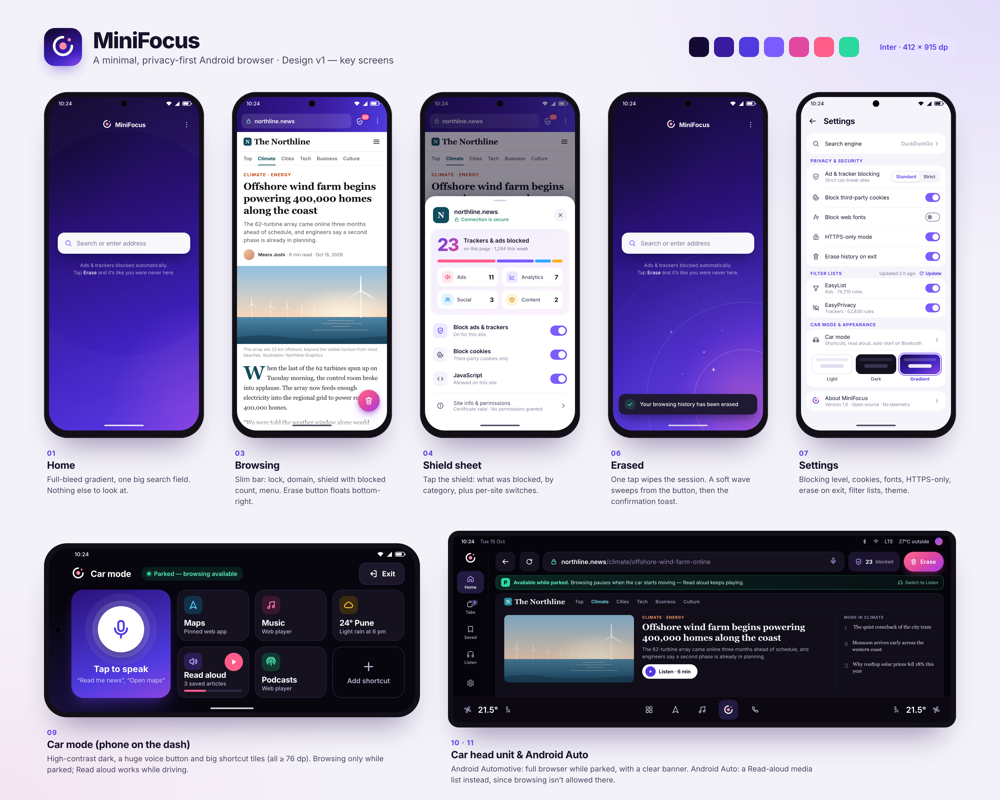

# MiniFocus (codename)

A minimal, privacy-first Android browser built on the system WebView — with ad/tracker blocking, one-tap Erase, and a car mode. UI inspired by the classic Firefox Focus.

**Status:** planning & design. No app code yet.

- 📋 [PLAN.md](PLAN.md) — scope, architecture, milestones, open questions
- 🎨 [design/](design/) — mockups + design system
- 🔎 [research/](research/) — Firefox Focus history, ad blocking in WebView, car-mode feasibility

*Not affiliated with Mozilla or Firefox.*
